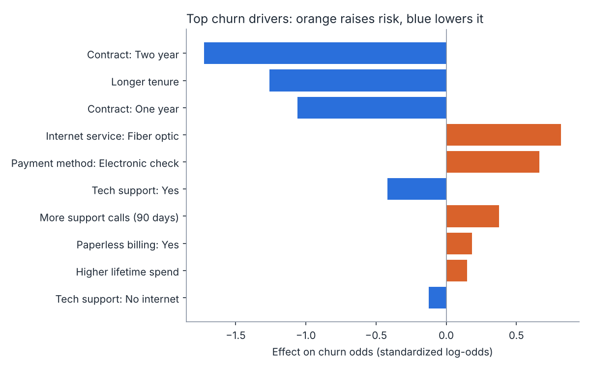

# Customer churn predictor

> **Personal project.** The data is synthetic, generated with a known churn formula so you can check whether the model finds the real drivers.

Predicts which telecom customers are likely to cancel, explains *why*, and produces a call list a retention team can act on.

## Results (latest run)

| Metric | Value | What it means |
| --- | --- | --- |
| ROC AUC | 0.83 | How well the model ranks risky customers above safe ones (0.5 = coin flip) |
| Recall | 75% | Share of real churners the model catches |
| Precision | 55% | Share of flagged customers who actually churn |
| Accuracy | 73% | Overall correct predictions |

The "always predicts stays" baseline gets ~69% accuracy but catches **zero** churners. That's why this project optimizes recall and F1, not accuracy. The decision threshold is tuned on a validation split, never on the test set.



Contract effects are compared against month-to-month, so "Two year" being strongly blue means two-year customers churn far less than month-to-month ones.

## Run it

```bash
python -m venv .venv && source .venv/bin/activate   # Windows: .venv\Scripts\activate
pip install -r requirements.txt
python run.py          # generate data, train, evaluate, write outputs/
python -m pytest -q    # 4 tests
```

## What it produces (`outputs/`)

- `SUMMARY.md`: one-page write-up for a non-technical manager
- `metrics.json`: all metrics plus a 3-model comparison (baseline, logistic regression, random forest, 5-fold CV)
- `churn_drivers.png`, `roc_curve.png`, `confusion_matrix.png`
- `retention_call_list.csv`: the 200 highest-risk customers who haven't left yet

## How it works

1. **Generate** (`src/generate_data.py`): 7,000 customers, ~31% churn, with realistic mess (missing totals for new customers).
2. **Clean**: fill missing totals, drop duplicate IDs.
3. **Compare models** with stratified 5-fold cross-validation. Logistic regression wins ties because its coefficients are explainable.
4. **Tune the threshold** to balance catching churners against false alarms.
5. **Explain**: rank coefficients, translate feature names into plain English.

## Design decisions worth talking about in an interview

- **Why not just maximize accuracy?** With a 31% churn rate, accuracy rewards ignoring churners.
- **Why logistic regression over random forest?** Similar AUC, and a manager can understand "two-year contracts cut risk."
- **How do you know it found real drivers?** The generator uses a known formula; a test checks the model recovers it.

## Next steps

- Swap in a real public dataset (for example, the IBM Telco customer churn dataset) and compare results.
- Add calibration so "70% risk" really means 7 in 10.
- Estimate dollar impact: expected saved revenue per retention call.
